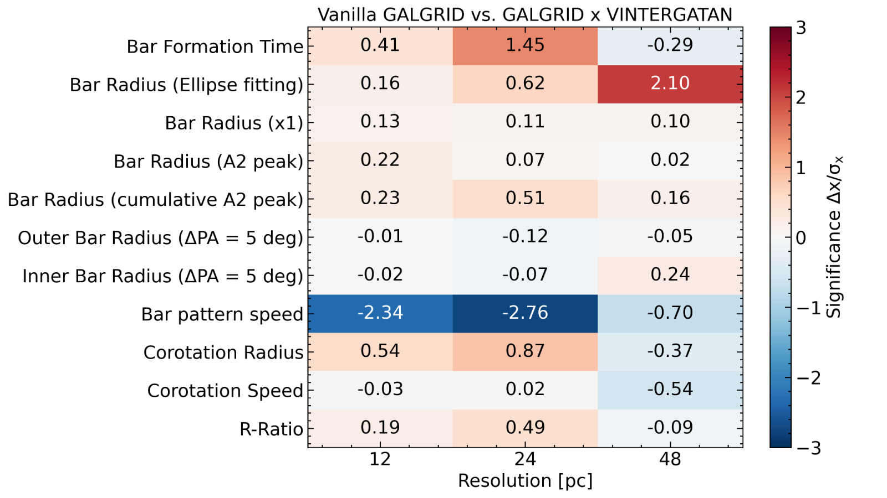
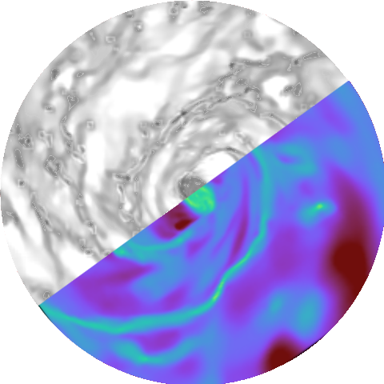

Observed disk galaxies exhibit diverse structural properties. Some galaxies host well defined structures such as spiral arms, bars and ring-like structures, while others appear largely unstructured or "flocculent". Understanding what drives the differences in these structures and how they might affect the galactic ecosystem and lifecycle is a central question of contemporary galaxy formation and evolution. 

While some of these structures might be attributed to interactions with the cosmological environment---tidal interactions and mergers---some might be spontaneously triggered by internal dynamics and thus depend on well-defined properties of the host galaxies themselves. Understanding this latter connection provides a relevant baseline for the classification of galaxies.

Thus far, the connection between host galaxy properties and their structures has been studied in depth using N-body simulations of stellar disks and their DM halos. However, a solid baseline for realistic galaxies, i.e. involving gas dynamics and thus processes such as radiative cooling, star formation and stellar feedback has been missing.

To address this missing link, Dr. Pierrick Verwilghen ran the largest simulation suite of 51 isolated disk galaxies, covering a relevant sample of the parameter space of isolated disk galaxies, that can tackle these questions thus far.
Pierrick analysed a representative subset of these **GALGRID** simulations, which lead to two publications that highlight an sudden transition in structural galaxy properties around a stellar mass of 1e10 Msol.

However, at the end of his PhD a large fraction of the massive GALGRID simulation dataset remained to be analyzed.
The aim of this project is to utilize the full GALGRID simulation suite to answer the pertinent question:
**What drives the fuelling of central gas reservoirs in disk galaxies?**

This work involves   

- What metrics can be used to classify and compare the structures found across the entire dataset?
- What properties of the initial conditions (e.g., stellar mass, disk fraction, length scales, etc) govern the emergence of structures and the radial transport that feeds central gas reservoirs?
- How sensitive are the findings to the physical model (feedback modelling, magnetic fields)? 

Below are some highlights and findings from our project.

## The Role of Numerics

  

    <h3 style="margin-top: 0;">GALGRID x Vintergatan</h3>
    

      All GALGRID simulations were run with the same basic subgrid prescriptions for star-formation, radiative cooling and stellar feedback. Moreover, all simulations were run at the fixed maximum resolution of about 12 pc. To explore how these numerical choices affect our conclusions, we reran one of the GALGRID galaxies, which roughly matches the Milky Way, with the more sophisticated Vintergatan physics model at 3 different resolutions.
    

    
We measured various bar properties and compared them to those of the original GALGRID simulation. An overview of the differences is shown above. Most bar properties are not sensitive to the subgrid physics and are well converged at 12 pc. Only the bar pattern speed appears to differ.

    
    

      What remains to be investigated is the impact on the central gas reservoir. A robust classification scheme that will work well for the whole GALGRID suite is currently under development.
      Moreover, MHD simulations are underway to quantify the role of magnetic fields.
    

  

  

    
  

(Last modified 16/11/2026)

[← Back to Research Overview](/research/)
