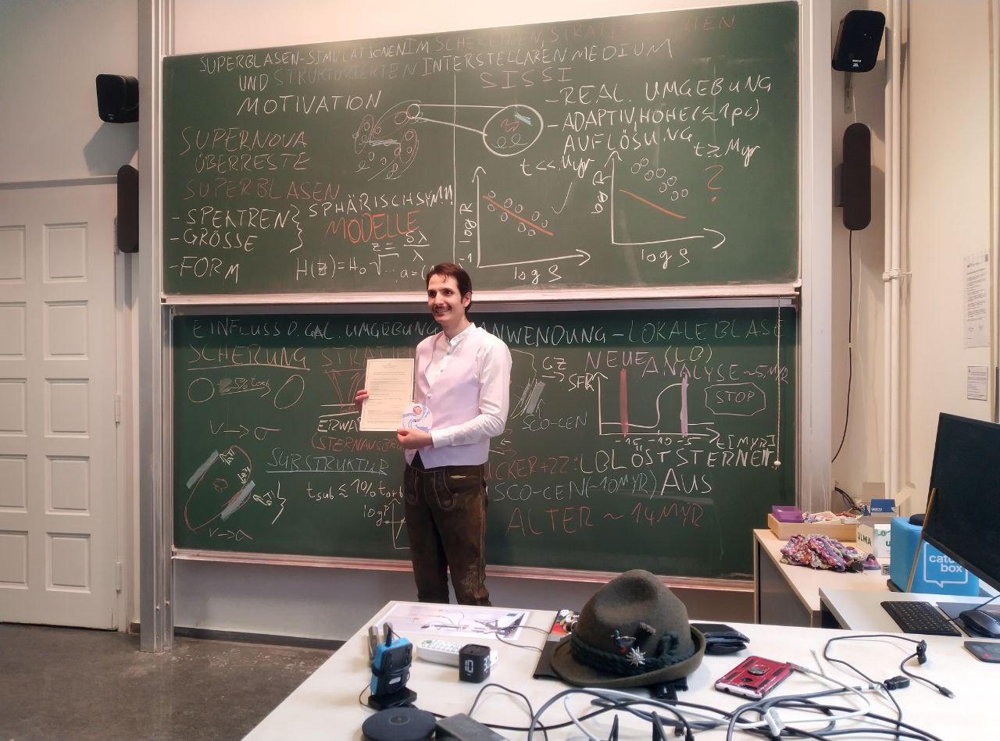

I am a theoretical astrophysicist at the ORIGINS cluster of Excellence in Munich. In my research, I combine numerical simulations with insights from analytical modelling to study various aspects of the galactic baryon cycle, from star-formation and stellar feedback to how matter is distributed and transported across the galaxies and their ecosystem.

## News

### 2026
**02/10/2026** Invited Talk about blastwave modelling in the Galaxy Formation Group Seminar at the Center for Computational Astrophysics in New York, USA.   
**30/09/2026** Invited Talk about starburst driven galactic outflows in the Fielding Group Meeting at New York University, USA.   
**25/09/2026** Invited Talk about bar-driven secular evolution in the Lars Hernquist Group Meeting at the Harvard Center for Astrophysics, USA.   
**24/09/2026** Invited Talk about the local bubble in the ITC Luncheon at the Harvard Center for Astrophysics, USA.   
**23/09/2026** Invited Talk about starburst driven galactic outflows in the High Energy Seminar at the Harvard Center for Astrophysics, USA.   
**16/09/2026** Invited Talk about bar-driven secular evolution in the Yale Galaxy Lunch at Yale University, USA.   
**15/09/2026** Invited Talk about bar identification in hydrodynamic simulations in the Data x Astro Seminar at Yalue University, USA.   
**11/09/2026** Invited Talk about bar-driven secular evolution in the UConn Astro Seminar at the University of Connecticut, USA.   
**09/09/2026** [New preprint](https://scixplorer.org/abs/2026arXiv260909729K/abstract) on the role of SIDM in DMDG-formation (PI: K. Kihara) on the arXiv.   
**07/07/2026** [New preprint](https://scixplorer.org/abs/2026arXiv260704901R/abstract) on blastwave modelling with FRANZ on the arXiv.   
**03/07/2026** [FRANZ.jl](https://doi.org/10.5281/zenodo.21076525) Julia package for modelling blastwave evolution goes live.   
**01/07/2026** Talk about blastwave modelling at EAS 2026 in Lausanne, Switzerland.   
**17/06/2026** Talk about blastwave modelling at [Galaxy evolution workshop](https://indico.fysik.su.se/event/9146/) in Nordita, Stockholm.   
**12/06/2026** [PHANGS Paper](https://scixplorer.org/abs/2026A%26A...710A.142B/abstract) on the life time of molecular clouds (PI: Z. Bazzi) published in A&A.   
**10/06/2026** Talk about bar-driven secular evolution at [Galaxy evolution workshop](https://indico.fysik.su.se/event/9146/) in Nordita, Stockholm.   
**01/03/2026** [Paper](https://scixplorer.org/abs/2026A%26A...707A..98R/abstract) on Local Bubble published in A&A.   
**06/02/2026** [PhD thesis](https://doi.org/10.5282/edoc.36502) published in the LMU university library.   
**06/01/2026** [Paper](https://scixplorer.org/abs/2026A%26A...705A..75M/abstract) about the role of grain-size evolution (PI: K. Matsumoto) published in A&A.   
**01/01/2026** Beginning of Postdoc at the ORIGINS cluster of Excellence in Munich (PI: Eric Emsellem).   

### 2025
**31/12/2025** PhD contract at USM Munich ended.   
**04/09/2025** [New preprint](https://doi.org/10.48550/arXiv.2509.04221) about new hints that the Local Bubble might be younger than previously assumed on the arXiv.   
**28/08/2025** [New preprint](https://scixplorer.org/abs/2025arXiv250821157M/abstract) about the role of grain-size evolution for galaxy attenuation curves on the arXiv (PI: K. Matsumoto)   
**27/08/2025** Successfully defended PhD. (GPA: 1.18; *magna cum laude*)   
**24/08/2025** Paper on starburst-driven galactic outflows accepted for publication in A&AL.   
**07/08/2025** Launched website.   
**06/08/2025** First SISSI paper accepted for publication in A&A.   
**16/07/2025** Submitted [PhD thesis](https://doi.org/10.5282/edoc.36502) on superbubbles in the ISM.  
**17/03/2025** Submitted first SISSI paper to A&A (Romano, Behrendt & Burkert): [2025arXiv250312977R](https://scixplorer.org/abs/2025arXiv250312977R/abstract)   
**17/03/2025** Submitted paper on starburst-driven galactic outflows to A&AL (Romano, Owen & Nagamine): [2025arXiv250313261R](https://scixplorer.org/abs/2025arXiv250313261R/abstract)

### 2024
**02/12/2024** Published paper on radial dust profiles in observed & simulated galaxies (Lead by S. van der Giessen): [2024A&A...692A..39V](https://scixplorer.org/abs/2024A%26A...692A..39V/abstract)   
**16/08/2024** Published paper on supernova implosion-driven star-formation (Romano, Burkert & Behrendt): [2024ApJ...971L..44R](https://scixplorer.org/abs/2024ApJ...971L..44R/abstract)   
**17/04/2024** Published paper on supernova implosion (Romano, Behrendt & Burkert): [2024ApJ...965..168R](https://scixplorer.org/abs/2024ApJ...965..168R/abstract)   
**02/02/2024** Published paper on observational signatures of grain-size evolution (Lead by K. Matsumoto): [2024A&A...689A..79M](https://scixplorer.org/abs/2024A%26A...689A..79M/abstract)   

### 2023
**28/06/2023** Fixed numerical bug in RAMSES ([commit f1bd65e](https://bitbucket.org/rteyssie/ramses/commits/f1bd65e)).   

### 2022
**29/08/2022** Published paper on observations of dust in local galaxies (Lead by M. Relaño): [2022MNRAS.515.5306R](https://scixplorer.org/abs/2022MNRAS.515.5306R/abstract)   
**19/05/2022** Published two papers on dust and molecules in the simulated ISM of Milky-Way-like galaxies in MNRAS (Romano, Nagamine & Hirashita): [2022MNRAS.514.1461R](https://scixplorer.org/abs/2022MNRAS.514.1461R/abstract), [2022MNRAS.514.1441R](https://scixplorer.org/abs/2022MNRAS.514.1441R/abstract)  
**09/03/2022** Contributed dust physics module to Grackle-3 ([PR #94](https://github.com/grackle-project/grackle/pull/94)).   
**01/02/2022** Joined the University Observatory Munich (USM) at the Ludwig-Maximilians University (LMU) as a doctoral researcher.   

### 2021
**11/2021** Completed M.Sc. with a thesis on dust and molecules in the simulated ISM of Milky-Way-like galaxies. (Advisor: K. Nagamine)   

