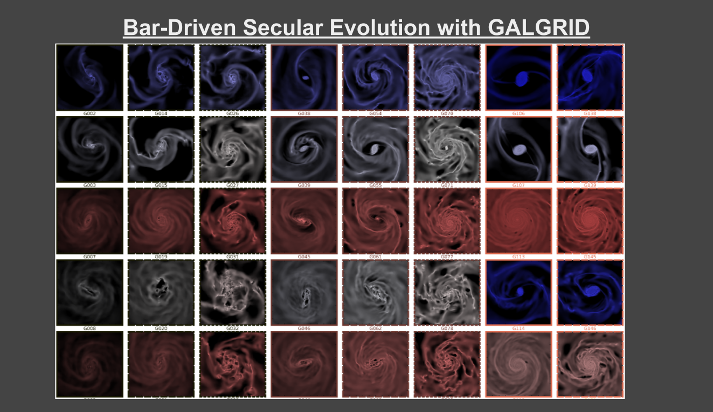
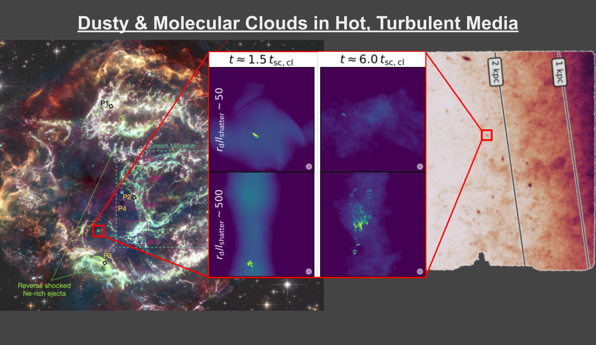
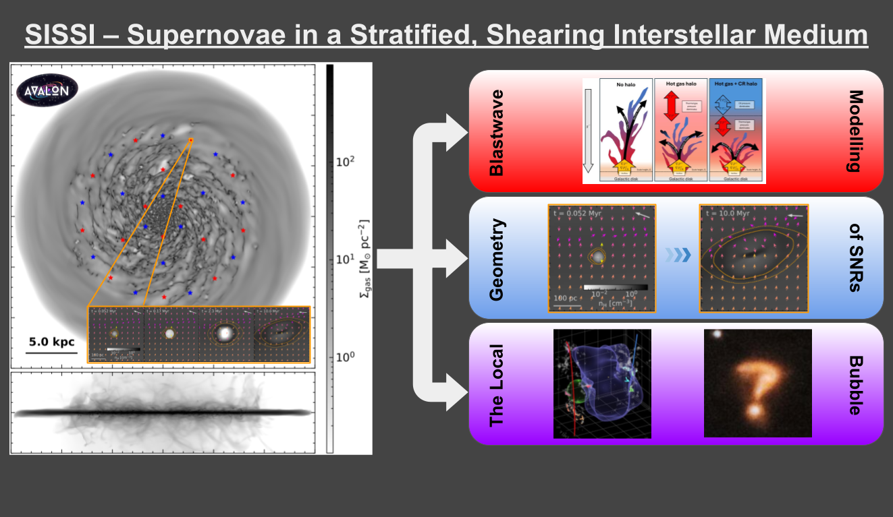
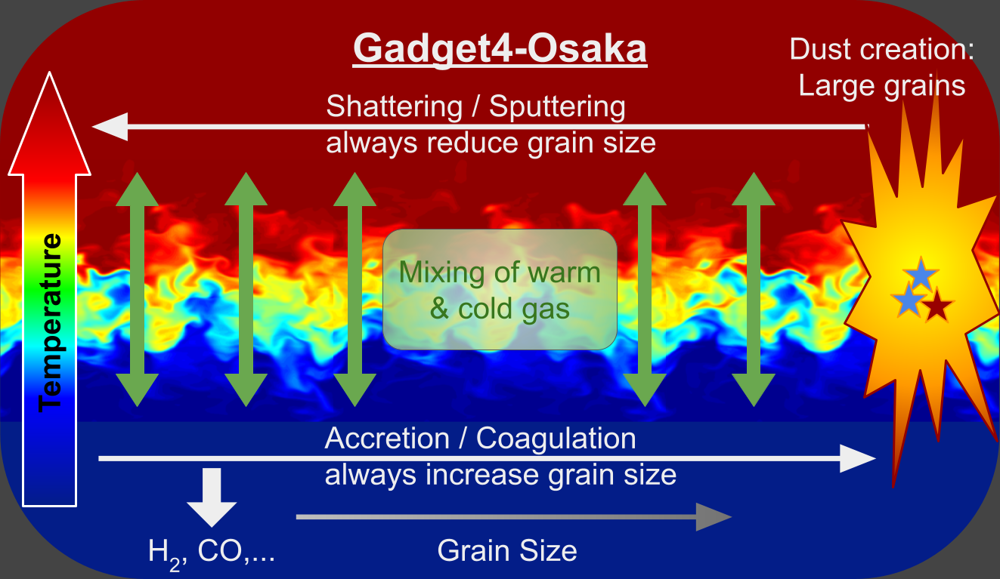

My research focuses on dynamical processes in the interstellar medium (ISM).   

During my M.Sc., I implemented state-of-the-art models for dust grain-size evolution for galaxy-scale simulations into the **Gadget4-Osaka** code and coupled them to molecular chemistry.   

During my PhD, I introduced the **SISSI project**, featuring numerical zoom-in simulations of superbubbles in the ISM of a simulated isolated Milky-Way-like galaxy to study how their dynamics are influenced by their turbulent galactic environment.   
Another outcome of this endeavour is the **FRANZ** code for blastwave evolution.   

My current work with Eric Emsellem focusses on **bar-driven secular evolution of galactic centers**, such as the central molecular zone in the Milky Way.   

Moving forward, I am planning to build on my expertise with grain-size evolution models and HPC applications to study the **survival of dust and molecules under extreme conditions**, such as those encountered in supernova remnants and the circumgalactic medium.   

Stay tuned to find out what's next!

Click on the thumbnails below to get an impression of the different projects I am involved in:

---
<!-- Grid container -->

   <!-- Project 4 -->
  

  <!-- Project 3 -->
  

  <!-- TBD: Bar-driven secular evolution-->
  
  <!-- Project 2 -->
  

  <!-- Project 1 -->
  

---

(Last modified 08.08.2025)
